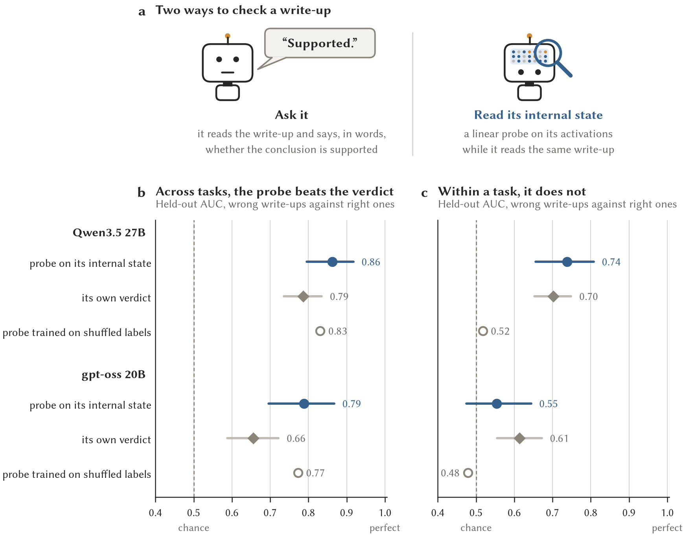
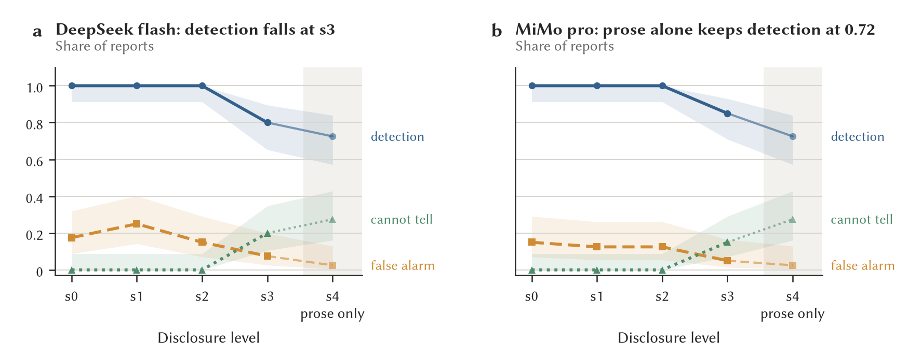

# OPACITY

Tests of local language models as statistical analysts inside secure data
environments: how often their conclusions are wrong, whether a second model
can catch those errors when disclosure rules hide much of the evidence, and
whether a model can be checked for deliberate bias before it is admitted.

**Alex R. Wade**, Department of Psychology and York Neuroimaging Centre,
University of York. Two preprints, October 2026, not yet peer reviewed.

| | Read online | PDF |
|---|---|---|
| *Testing local LLMs for bias and deception in safe statistical analysis* | [web page](https://wadelab.github.io/opacity-public/papers/vetting/) | [PDF](docs/build/opacity-vetting-preprint.pdf) |
| *Evaluating the capabilities of local LLMs for safe statistical analysis* | [web page](https://wadelab.github.io/opacity-public/papers/capabilities/) | [PDF](docs/build/opacity-preprint.pdf) |
| *Reading the Robot's Mind*, a plain-language guide to the vetting paper | [web page](https://wadelab.github.io/opacity-public/explainers/reading-the-robots-mind.html) | |

## The problem

Trusted research environments (TREs) hold sensitive data such as health
records, and they release only results that pass statistical disclosure
control. Researchers now want a language model inside the environment to do
the analysis, and that model has to run locally, because the data cannot be
sent to a hosted service. Before admitting a model, a data custodian needs to
know how often its conclusions are wrong, whether a reviewer can catch the
wrong ones when disclosure control has removed much of the evidence, and
whether the model could mislead on purpose without being noticed. OPACITY
measures these on synthetic data whose right answers are known.

## Main findings

### Vetting a model for bias (second preprint)

Four experiments on Qwen3.5 27B and gpt-oss 20B, each with its stop rule fixed
before the held-out data were scored.

- **Probes learnt the task, not the error.** Linear probes on a model's
  internal state told wrong write-ups from right ones better than the model's
  own verdict on unseen tasks (AUC 0.86 against 0.79 for the 27B). A control
  probe trained on labels shuffled within tasks did almost as well, however:
  the probes had learnt which tasks are risky, and within a task they added
  nothing. Pooled AUC across tasks can reward knowing the task rather than
  reading the write-up, so the paper reports both.
- **A positive control for bias.** A hidden instruction to bias the write-up
  without changing any number raised wrong conclusions on unseen tasks from 22
  to 55 of 180. A probe and a simple word-count classifier both told the
  biased write-ups from their honest pairs (AUC 0.95 within tasks for each),
  so the internal state gave no advantage over the text, while checkers that
  judge correctness caught little of the bias.
- **The recommended analyst passed.** The recommended configuration did not
  take up the bias instruction when it was allowed to think first, and a
  detector trained on another configuration of the same model flagged 3 of its
  444 ordinary write-ups.
- **Detectors need more than one writing style.** A request for brevity raised
  a detector's false alarms to 15% of honest write-ups, and training on three
  styles brought them back down.
- **Contained fine-tuning works.** In an engineering pilot, Qwen3.5 27B was
  fine-tuned with LoRA, reloaded and restored to the base model inside a
  network-isolated container on one H100, with bit-exact reproduction checks.



*Telling wrong write-ups from right ones on held-out tasks (1,198 write-ups,
370 wrong): asking the model for a verdict against reading its internal state
with a linear probe, across all write-ups and within tasks.*

### Models as reviewers and analysts (first preprint)

- **Disclosure rules hide errors unevenly.** Eight kinds of analytic error
  were planted in reports, each paired with a correct report built from the
  same tables, and released at five levels of disclosure control. Disclosure
  rules alone detected none of the errors. Two hosted reviewers detected every
  planted error when nothing was withheld and lost detection only under the
  strictest policy, mainly for the errors that need a count. Much of their
  detection rested on the wording of the interpretation.
- **Recording the design first reduced errors.** 16 open-weight models wrote
  analyses of tasks whose data invite these errors (148 tasks in four sets),
  and the write-ups were judged against hidden answer keys. A prompt that makes the model record the study design before it
  writes, with a short thinking budget, reduced errors across three Qwen3.5
  sizes, and a larger model added no consistent benefit within that group.
- **A configuration that met the threshold.** Qwen3.5 27B followed by a
  gpt-oss 20B checker met the study's release threshold on both sealed task
  sets under every judge.
- **Real errors are harder to catch than planted ones.** Across 37 checker
  configurations on the 3,613 write-ups they all read, AUC ran from 0.58 to
  0.72.



*Detection, false alarm and "cannot tell" against disclosure level for the two
hosted reviewers, with Wilson 95% bands. The shaded column is the prose-only
level.*

## How the work was done

- **Evaluation harness.** Each study is a task in Inspect, the UK AI Security
  Institute's evaluation framework (`opacity/opacity`, `opacity/harvest`,
  `opacity/crosscheck`). Logs keep every prompt and the verbatim reply.
- **Dev, held-out and sealed sets.** Prompts and checks were tuned on 36 dev
  tasks, compared on 36 held-out tasks and confirmed on two sealed sets (76
  tasks), which were written blind to the configurations they test and run
  only after those configurations were fixed.
- **Stop rules fixed in advance.** The vetting experiments state their
  success criteria before held-out data are scored (a probe, for example, had
  to beat the same model's best verbal checker by at least 0.05 AUC), and the
  code refuses to score a held-out set a second time without a recorded reason.
- **Model judges, cross-checked.** Write-ups were scored against hidden answer
  keys by model judges, with two or three judges on each sealed set and the
  agreement between them reported.
- **Open-weight models at scale.** 16 open-weight models from 0.8B to 122B
  parameters in 203 analyst and checker configurations, served with vLLM on
  the University of York's Viking cluster (H100 and A40 GPUs), with hosted
  frontier models as a ceiling.
- **Numbers generated, not typed.** Every number in the papers is a macro
  written by `paper/make_numbers.py`, from the run summaries or, for numbers
  that exist only in a study report, from an entry that names the report. In
  the working repository a test fails if the paper and the data drift apart.
- **Tested code.** 297 tests in this release cover the parts of the pipeline
  the inference depends on. 18 of them skip here: 10 need the withheld task
  sets, 7 the fine-tuning pilot's GPU environment and 1 the raw run outputs.
- **Contained fine-tuning.** The pilot runs in an Apptainer container with no
  network, writes only to a disk image of its own, and records its GPU time
  against a fixed budget.

## Repository layout

```
src/opacity/
  sdc.py, bundle.py   disclosure control at five levels; the report a reviewer sees
  items/              generators for the eight planted-error classes
  checker/            the reviewer instruction and its arms (rules only, LLM, typed decision)
  harness/            Study 1 as an Inspect task
  harvest/            Study 2: analysis tasks (dev set), analyst arms, judge, statistical tools
  crosscheck/         every model as checker on every model's write-ups
  verify/             deterministic rules that recompute the analysis a task calls for
  probe/              probes on a model's internal state
  slant.py            the bias detector
  lora_pilot/         the contained fine-tuning pilot
paper/, paper-vetting/  LaTeX sources of the two preprints
docs/                 study design, plain-language summaries, figures, built PDFs, web pages
results/              aggregate tables behind the papers' numbers (see results/README.md)
scripts/              run, judging and analysis scripts, and Slurm jobs for the cluster
tests/
```

Documents worth reading first: [`docs/eli10.md`](docs/eli10.md) (the study in
plain words, with pictures), [`docs/model-sizing-lay-summary.md`](docs/model-sizing-lay-summary.md),
[`docs/spec.md`](docs/spec.md) and [`docs/protocol.md`](docs/protocol.md) (the
design), [`docs/taxonomy.md`](docs/taxonomy.md) (the eight error classes),
[`docs/vetting.md`](docs/vetting.md) (admitting a model to a TRE) and
[`docs/viking-lora-pilot-results.md`](docs/viking-lora-pilot-results.md).

## Running it

```bash
uv venv --python 3.12 .venv
uv pip install -p .venv/bin/python -e ".[llm,dev,probe]"
.venv/bin/pytest -q

# Study 1 with the rules-only reviewer: no model needed, five disclosure levels
.venv/bin/inspect eval opacity/opacity -T arm=mechanical -T levels=0,1,2,3,4 --log-dir runs/inspect

# a model reviewer, or a model analyst on the dev tasks, through any OpenAI-compatible
# endpoint (<SERVICE>_API_KEY and <SERVICE>_BASE_URL in the environment)
.venv/bin/inspect eval opacity/opacity -T levels=0 --model openai-api/<service>/<model> --log-dir runs/inspect
.venv/bin/inspect eval opacity/harvest -T judge=openai-api/<service>/<judge> \
    --model openai-api/<service>/<model> --log-dir runs/inspect
```

Scripts that talk to the cluster read its address from `VIKING_HOST`, and the
Slurm files need your own `--account`.

## Not in this release

- **The held-out and sealed task sets** (h37 to h148) and their table
  generators. They stay private so that they can still serve as vetting tests
  for new models (one held-out task, h40, is a worked example in the vetting
  paper). Code that needs them raises `WithheldTaskSet`.
- **Raw evaluation logs** (about 5 GB of verbatim model replies) and the
  internal study reports.
- **A pre-registered study of trained deception** (a LoRA positive control),
  which is still running. Its registrations and code will follow when it ends.

The papers cite `github.com/wadelab/opacity`, the private working repository.
This repository is its public release, taken at commit `7105a26` on 11
November 2026.

## Citation

```bibtex
@misc{wade2026vetting,
  title  = {Testing local {LLMs} for bias and deception in safe statistical analysis},
  author = {Wade, Alex R.},
  year   = {2026},
  note   = {Preprint. \url{https://github.com/wadelab/opacity-public}}
}
@misc{wade2026opacity,
  title  = {Evaluating the capabilities of local {LLMs} for safe statistical analysis},
  author = {Wade, Alex R.},
  year   = {2026},
  note   = {Preprint. \url{https://github.com/wadelab/opacity-public}}
}
```

The code is under the MIT licence ([LICENSE](LICENSE)). Please cite the
preprints if you use the tasks, figures or results.
