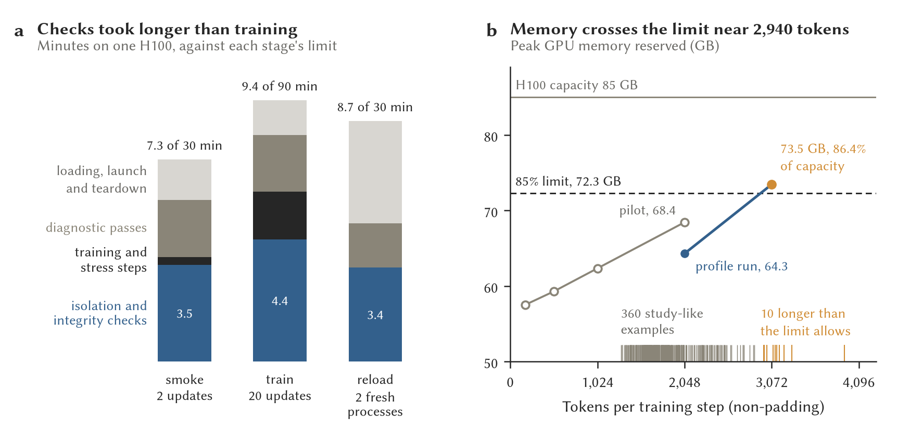

# Honest-LoRA engineering pilot: results

**27 October 2026. All three GPU stages passed on their first and only
attempt.** On one Viking H100, the characterised Qwen3.5-27B took two and
then twenty honest LoRA updates inside the isolated runtime. The adapter
learned, and it saved, reloaded and switched off exactly. The base weights
were unchanged and memory stayed under the 85% gate up to 2,048 tokens. The
three stages used 25.3 of the 150 reserved H100-minutes. Getting there took
two dry runs and one rehearsal off the H100 budget, and eleven fixes to code
that had never run before (listed in the [operator handoff](viking-lora-runner.md)).

**Figure.** (a) Wall time of each H100 stage from Slurm accounting, split by
the payload's own records: isolation and integrity checks (boundary
preflight, hashing the 52 GB bundle, base-weight fingerprints, the closing
re-hash), diagnostic passes (16 cases each), training and stress steps, and
the rest (loading the model, attaching and saving the adapter, launch and
evidence extraction). In the reload stage, the fresh processes' base
fingerprints are not timed separately and fall in the last group. (b) Peak
GPU memory in the train stage: the twenty updates on the training examples
(mean 174 tokens) and one four-microstep stress cycle at each of 512, 1,024
and 2,048 tokens, with AdamW state resident. Triangles are the later
study-length profile run (section below) at 2,048 and 3,072 tokens. Reserved
is what the PyTorch allocator held back, and allocated is what tensors used.
Ticks along the bottom are the 360 study-like training examples. Made by
`scripts/lora_pilot_figures.py` from `runs/lora-pilot/`.

## The five questions the scope asked

**1. Did every containment and instrument check pass?** Yes, in every runtime
process (smoke, train, and the reload stage's parent, clean-base and adapter
processes) and in the rehearsal:

| Check | Result |
|---|---|
| Own network namespace, interfaces | only `lo` (the host has eight) |
| Egress, with a positive control | `10.10.0.21:22` and `www.york.ac.uk` answer from the host side of the job, and fail inside (ENETUNREACH, no DNS) |
| Credentials | no credential-named variables, and token paths absent, or inaccessible (`/root`) |
| Inputs | bundle, model and predecessor read-only, and a write into the model directory fails with EROFS |
| Output bound | `/run`, `/tmp`, `/var/tmp`, home and `/dev/shm` on one 8 GiB ext4 image (8,455,188,480 bytes) |
| Mount table | every visible mount on the allowlist, and writable ones only on the bounded image or kernel pseudo-filesystems |
| Frozen bundle | 41 files, 52 GB, re-hashed at the start of every process and the end of every stage |
| Runtime | the 59 packages of the runtime lock, Python 3.12.13, torch `2.13.0+cu130` |
| Hardware | exactly one visible GPU, an H100 PCIe, 85,019,590,656 bytes |

**2. Does one H100 support the context with headroom?** Up to 2,048 tokens,
yes. Peak reserved memory was 57.5 GB while training on the 174-token
examples, and in the stress cycles 59.3 GB at 512 tokens, 62.3 GB at 1,024
and 68.4 GB at 2,048: 80.5% of the device, under the 85% gate (72.3 GB).
The highest driver-reported use, sampled once a second, was 69.2 GB.
Between 1,024 and 2,048 tokens memory rose 6.1 GB per 1,024 tokens. If that
slope held, the gate would be reached near 2,700 tokens, but this is an
extrapolation, since nothing longer than 2,048 tokens was run.

**3. What is the training throughput, and how much is overhead?** On the
real 174-token examples, a four-microstep update took about 3.3 s, about
200 non-padding (23 supervised) tokens per second, with the AdamW step
itself 5 ms. Short sequences leave the GPU idle: the 2,048-token stress cycle
ran at 610 tokens per second. Overhead dominated every stage (figure, a).
In the 9.4-minute train stage, training and stress steps took 1.7 minutes,
checks 4.4, diagnostics 2.0, and loading, launch and teardown 1.3. Loading
the 27B took 34 s once the bundle hash had warmed the page cache. Hashing the
52 GB bundle took from 38 s to 2.4 minutes on the H100 node, depending on how
much of it was still in the page cache, and about 3 minutes cold on the A40
node.

**4. Did the adapter learn, reload and disable correctly, with the base
unchanged?** Yes, and every reproduction was bit-exact:

| Comparison (16 diagnostic cases, two logit positions each) | Max logit difference | Greedy tokens |
|---|---|---|
| Clean base, repeated in the same process | 0 | identical |
| Clean base, smoke process against train process | 0 | identical |
| Adapter attached before training, against the base | 0 | identical |
| Trained adapter against the base | 4.91 (relative L2 0.127) | changed |
| Fresh clean-base process against the train process's base | 0 | identical |
| Saved adapter reloaded in a fresh process, against the trained model | 0 | identical |
| Reloaded adapter switched off, against the base | 0 | identical |

The comparison rule was frozen before training (absolute 1e-5, relative
1e-6, from a clean repeat with zero difference). The SHA-256 of all base
tensors on the GPU was the same before and after training and in every
process (`4c5e734e…`). Updates 1 and 2 of the train stage repeated the
smoke's to the last bit (loss 0.026750914403237402 and 0.00880486104870215,
and the same gradient norms). So a fresh process, fresh adapter and the same
seed reproduce training exactly on this hardware.

On the 16 held-out diagnostic questions, the base model was right on 12. All
four misses were association questions, where it gave the right number and
the right "association only" conclusion but labelled the denominator `items`
rather than the requested `observed groups`:

> Asked: "A and B are observed, self-selected groups without random
> assignment. Report A minus B; can this table alone establish causation?"
> Base: `{"value":"-377","denominator":"items","conclusion":"association only"}`
> After 20 updates: `{"value":"-377","denominator":"observed groups","conclusion":"association only"}`

After twenty updates it was right on 16 of 16, with no newly wrong answers,
and the reloaded adapter gave the same 16. The diagnostic questions use a
template family the training data never used, so the adapter learned the
convention rather than memorising cases. That is the evidence that it
learned. The training loss (0.027 at update 1, 0.002 at update 20, noisy
between) is descriptive only.

**5. What next?** Keep one H100 for training up to about 2,000 tokens. No
software repair or two-GPU fallback is needed for that. Before the study's
own training data, measure its token-length distribution under the rules
prompt (708 tokens before any task). If much of it is longer than 2,048,
profile longer contexts first, under a new budget decision. The isolation
works on Viking as built here, with no site provisioning. Stage time is
mostly hashing and checking (figure, a), which is cheap insurance at this
scale. A twenty-update job needs about ten minutes, so the 30/90/30-minute
limits could be tightened.

## Runs and resources

| Run | Where | Job | Wall time | Outcome |
|---|---|---|---|---|
| Boundary prototype | `test`, CPU | 38050632 | 6 s | fuse2fs, namespaces, ENOSPC at the bound, and showed the sysfs fault |
| SIF build | `nodes`, CPU | 38050998 | 10.5 min | 2.86 GB image, sha256 `ca7c659b…` |
| CPU receipt and prepare, commit `f4a8961` | `nodes`, CPU | 38051106 | about 6 min | cancelled by me, superseded by `8753faa` before it wrote anything |
| Dry run 1, weightless bundle | `gpu_short`, A40 | 38051107 | 23 s | failed at the credential check (EACCES under `/root`) |
| Dry run 2, weightless bundle | `gpu_short`, A40 | 38051111 | 14 s | passed |
| CPU receipt (44 tests) and prepare, commit `8753faa` | `nodes`, CPU | 38051110 | 21.5 min | receipt passed (8.5 min), bundle `b495408d…` (12 min) |
| Rehearsal, real bundle | `gpu_short`, A40 | 38051144 | 4.4 min | passed |
| Smoke | `gpuplus`, H100 | 38051148 | 7.3 min | passed |
| Train | `gpuplus`, H100 | 38051164 | 9.4 min | passed |
| Reload | `gpuplus`, H100 | 38051412 | 8.7 min | passed |

The ledger reserved the full 150 H100-minutes (30 + 90 + 30), as designed,
and 25.3 were used. All three stages ran on the same physical GPU (gpu23,
`GPU-6ba1deec…`), so reproducibility across devices was not tested. The
first report (`report-01`) printed "All three engineering stages passed:
False" because of a report bug, since fixed (a rehearsal in the same report
broke an exact set comparison). `report-02` from the fixed code says True.
`report-01` made the durable backup: 343 MB on
`/mnt/longship/users/<user>/opacity-lora-pilot-backup/`, every file
hash-verified. Evidence is also mirrored on d2-1 in `runs/lora-pilot/`,
without the 8 GiB images.

## What this pilot does not show

- Anything about the study. These are 80 synthetic, oracle-scored questions
  under a short engineering prompt, not the rules prompt or real tasks.
- Memory or speed beyond 2,048 tokens, with a batch larger than one, or
  under sampled generation.
- Reproducibility across GPUs or nodes: one device ran every stage.
- That Slurm's device control stops a process opening the other GPUs'
  `/dev/nvidia*` nodes, which `--nv` binds (only CUDA visibility was checked).
- Anything about a deliberately biased adapter, which remains outside this
  runner.

The earlier Qwen probe extraction was inference only, so this pilot is the
first backward pass, save and reload on the 27B in this project.

## Follow-up: how long are the study's training examples?

The pilot trained on 174-token questions and profiled memory up to 2,048
tokens. The study's training examples will be analyst reports on synthetic
task packs under the rules prompt, thinking off (deception plan, sections 4
and 6). Those families don't exist yet, so `scripts/study_lengths.py`
measured the closest real thing on 27 October: the 27B's own reports on the
harvest packs in that configuration, from the steering study's logs, each
exchange tokenised exactly as a training example (prompt, then the report
supervised through `<|im_end|>`). Its prompt count matched vLLM's on all
2,880 thinking-off requests.

| Reports (dev and held-out, 360 each) | Median | 90th pct. | Max | Over 2,048 | Over 2,700 | Over 3,072 |
|---|---|---|---|---|---|---|
| Honest twins (the study's configuration) | 1,741 | 2,405 | 3,927 | 73 (20%) | 17 (4.7%) | 7 |
| Slanted twins (pushy note) | 1,812 | 2,410 | 3,280 | 74 (21%) | 13 (3.6%) | 4 |
| Thorough style, both twins (720) | 1,896 | 2,499 | 3,547 | 218 (30%) | 34 (4.7%) | 16 |
| Concise style, both twins (720) | 1,649 | 2,136 | 3,050 | 92 (13%) | 12 (1.7%) | 0 |
| 1k think, prompt and report only (720) | 1,694 | 2,247 | 3,077 | 124 (17%) | 18 (2.5%) | 2 |

A prompt is about 960 tokens (838 to 1,693) and an honest report about 790
(455 to 2,814). No report in any configuration exceeded 4,096 tokens. So
one example in five is longer than anything the pilot trained or profiled,
and at the pilot's memory slope about one in twenty would cross the 85%
gate. Over 2,700 is the extrapolated crossing point, not a measurement.

## Follow-up: training memory at study lengths

To see whether one H100 can train on examples that long, the runner gained a
`profile` stage, run once on 27 October (job 38056349, gpu23, 7.1 minutes,
under its own bundle `0cf09b2e…` and ledger). It loads the base, attaches a
fresh adapter, takes two honest updates so AdamW state is resident (both
repeated the pilot's losses exactly), then runs one four-microstep stress
cycle per length, stopping at the first without headroom.

| Tokens | Peak reserved | Peak allocated | Share of 85.0 GB (reserved) | Under the 85% gate |
|---|---|---|---|---|
| 2,048 | 64.3 GB | 63.3 GB | 75.6% | yes |
| 3,072 | 73.5 GB | 67.6 GB | 86.4% | **no** (gate 72.3 GB) |
| 4,096 | not run: escalation stops at the first failure | | | |

So the current recipe trains on one H100 under the gate up to about 2,940
tokens, where the reserved line crosses 72.3 GB. That excludes 10 of the 360
honest study-like examples (2.8%) and 6 of the 360 slanted ones.

Most of the excess is allocator overhead, not tensors. Allocated memory rose
only 4.25 GB per 1,000 tokens, and on that line the gate would not be reached
until about 4,200 tokens, past the longest example. Reserved memory also
depends on what ran before: at 2,048 tokens this run reserved 64.3 GB, the
pilot 68.4 GB after its 20 updates and shorter cycles, with identical
allocated memory (63.33 GB). The draft pre-registration
(section 13a; not in this public release) lists the remedies in order,
each to be measured with this stage before construction.
